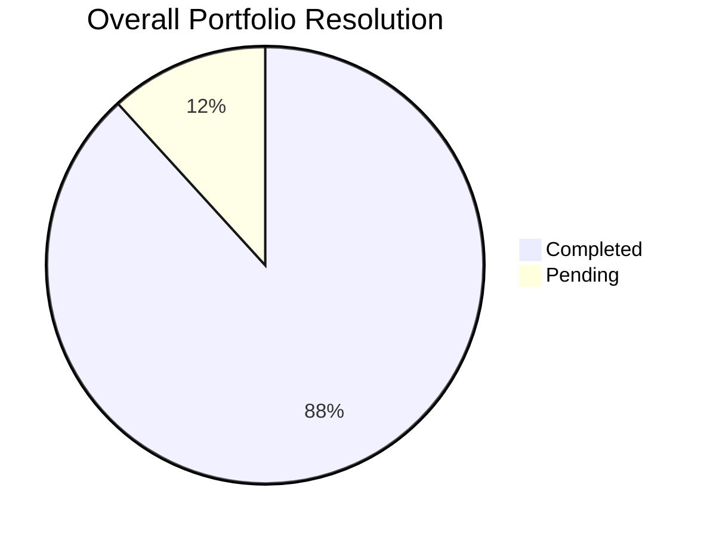

# 🌐 Global Task & Productivity Summary

> Aggregated analytics across all repositories and client projects.

## 🏆 Executive Summary

- **Total Tasks Logged**: `68`
- **Total Completed**: `60` (✅)
- **Total Pending**: `8` (⏳)
- **Overall Completion Rate**: `88.2%`

## 🏢 Project-Wise Breakdown

| Project | Total Tasks | Completed | Pending | Completion Rate | Dashboard |
| :--- | :---: | :---: | :---: | :---: | :---: |
| **ERP** | 1 | 1 | 0 | 100.0% | [View Analytics](./ERP/Analytics.md) |
| **i-Next** | 1 | 1 | 0 | 100.0% | [View Analytics](./i-Next/Analytics.md) |
| **Koha** | 6 | 6 | 0 | 100.0% | [View Analytics](./Koha/Analytics.md) |
| **KUD** | 17 | 14 | 3 | 82.4% | [View Analytics](./KUD/Analytics.md) |
| **Room_Booking** | 1 | 1 | 0 | 100.0% | [View Analytics](./Room_Booking/Analytics.md) |
| **Sanchay** | 39 | 35 | 4 | 89.7% | [View Analytics](./Sanchay/Analytics.md) |
| **Staff_Establishment_HR** | 3 | 2 | 1 | 66.7% | [View Analytics](./Staff_Establishment_HR/Analytics.md) |

## 📅 Multi-Period Performance

### 📆 Daily Aggregates
| Date | Created | Resolved | Pending | Day Completion |
| :---: | :---: | :---: | :---: | :---: |
| 18-11-2026 | 4 | 4 | 0 | 100% |
| 17-11-2026 | 7 | 7 | 0 | 100% |
| 13-11-2026 | 4 | 3 | 1 | 75% |
| 12-11-2026 | 10 | 10 | 0 | 100% |
| 11-11-2026 | 7 | 5 | 2 | 71% |
| 07-11-2026 | 3 | 3 | 0 | 100% |
| 06-11-2026 | 7 | 7 | 0 | 100% |
| 05-11-2026 | 6 | 5 | 1 | 83% |
| 04-11-2026 | 4 | 3 | 1 | 75% |
| 03-11-2026 | 9 | 6 | 3 | 67% |
| 02-11-2026 | 7 | 7 | 0 | 100% |

### 🗓️ Weekly Summary
| Week | Total Tasks | Resolved | Pending | Weekly Efficiency |
| :---: | :---: | :---: | :---: | :---: |
| 2026-W47 | 11 | 11 | 0 | 100% |
| 2026-W46 | 21 | 18 | 3 | 86% |
| 2026-W45 | 36 | 31 | 5 | 86% |

### 📊 Monthly Overview
| Month | Total Tasks | Resolved | Pending | Resolution Rate |
| :---: | :---: | :---: | :---: | :---: |
| November 2026 | 68 | 60 | 8 | 88% |

---
*Dashboard auto-updated by GitHub Actions.*