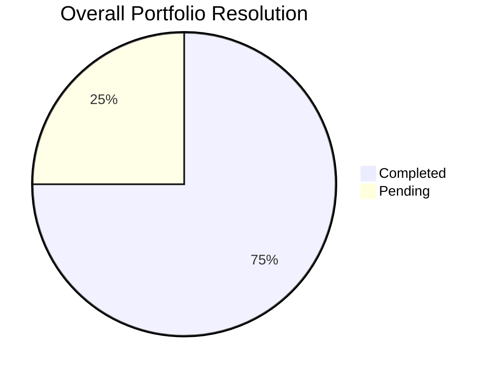

# 🌐 Global Task & Productivity Summary

> Aggregated analytics across all repositories and client projects.

## 🏆 Executive Summary

- **Total Tasks Logged**: `20`
- **Total Completed**: `15` (✅)
- **Total Pending**: `5` (⏳)
- **Overall Completion Rate**: `75.0%`

## 🏢 Project-Wise Breakdown

| Project | Total Tasks | Completed | Pending | Completion Rate | Dashboard |
| :--- | :---: | :---: | :---: | :---: | :---: |
| **Koha** | 1 | 0 | 1 | 0.0% | [View Analytics](./Koha/Analytics.md) |
| **KUD** | 6 | 4 | 2 | 66.7% | [View Analytics](./KUD/Analytics.md) |
| **Sanchay** | 11 | 10 | 1 | 90.9% | [View Analytics](./Sanchay/Analytics.md) |
| **Staff_Establishment_HR** | 2 | 1 | 1 | 50.0% | [View Analytics](./Staff_Establishment_HR/Analytics.md) |

## 📅 Multi-Period Performance

### 📆 Daily Aggregates
| Date | Created | Resolved | Pending | Day Completion |
| :---: | :---: | :---: | :---: | :---: |
| 04-11-2026 | 4 | 3 | 1 | 75% |
| 03-11-2026 | 8 | 5 | 3 | 62% |
| 02-11-2026 | 6 | 6 | 0 | 100% |
| 03-10-2026 | 1 | 0 | 1 | 0% |
| 02-10-2026 | 1 | 1 | 0 | 100% |

### 🗓️ Weekly Summary
| Week | Total Tasks | Resolved | Pending | Weekly Efficiency |
| :---: | :---: | :---: | :---: | :---: |
| 2026-W45 | 18 | 14 | 4 | 78% |
| 2026-W40 | 2 | 1 | 1 | 50% |

### 📊 Monthly Overview
| Month | Total Tasks | Resolved | Pending | Resolution Rate |
| :---: | :---: | :---: | :---: | :---: |
| October 2026 | 2 | 1 | 1 | 50% |
| November 2026 | 18 | 14 | 4 | 78% |

---
*Dashboard auto-updated by GitHub Actions.*