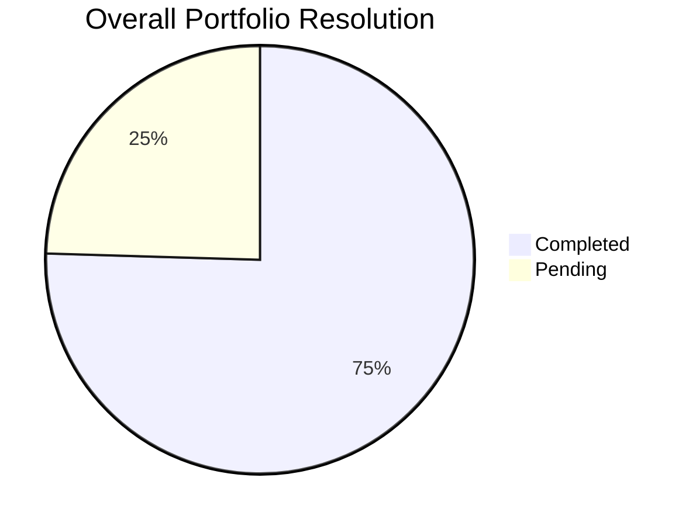

# 🌐 Global Task & Productivity Summary

> Aggregated analytics across all repositories and client projects.

## 🏆 Executive Summary

- **Total Tasks Logged**: `53`
- **Total Completed**: `40` (✅)
- **Total Pending**: `13` (⏳)
- **Overall Completion Rate**: `75.5%`

## 🏢 Project-Wise Breakdown

| Project | Total Tasks | Completed | Pending | Completion Rate | Dashboard |
| :--- | :---: | :---: | :---: | :---: | :---: |
| **ERP** | 1 | 1 | 0 | 100.0% | [View Analytics](./ERP/Analytics.md) |
| **i-Next** | 1 | 1 | 0 | 100.0% | [View Analytics](./i-Next/Analytics.md) |
| **Koha** | 4 | 2 | 2 | 50.0% | [View Analytics](./Koha/Analytics.md) |
| **KUD** | 13 | 10 | 3 | 76.9% | [View Analytics](./KUD/Analytics.md) |
| **Sanchay** | 32 | 25 | 7 | 78.1% | [View Analytics](./Sanchay/Analytics.md) |
| **Staff_Establishment_HR** | 2 | 1 | 1 | 50.0% | [View Analytics](./Staff_Establishment_HR/Analytics.md) |

## 📅 Multi-Period Performance

### 📆 Daily Aggregates
| Date | Created | Resolved | Pending | Day Completion |
| :---: | :---: | :---: | :---: | :---: |
| 12-11-2026 | 10 | 7 | 3 | 70% |
| 11-11-2026 | 7 | 4 | 3 | 57% |
| 07-11-2026 | 3 | 3 | 0 | 100% |
| 06-11-2026 | 7 | 6 | 1 | 86% |
| 05-11-2026 | 6 | 5 | 1 | 83% |
| 04-11-2026 | 4 | 3 | 1 | 75% |
| 03-11-2026 | 9 | 5 | 4 | 56% |
| 02-11-2026 | 7 | 7 | 0 | 100% |

### 🗓️ Weekly Summary
| Week | Total Tasks | Resolved | Pending | Weekly Efficiency |
| :---: | :---: | :---: | :---: | :---: |
| 2026-W46 | 17 | 11 | 6 | 65% |
| 2026-W45 | 36 | 29 | 7 | 81% |

### 📊 Monthly Overview
| Month | Total Tasks | Resolved | Pending | Resolution Rate |
| :---: | :---: | :---: | :---: | :---: |
| November 2026 | 53 | 40 | 13 | 75% |

---
*Dashboard auto-updated by GitHub Actions.*