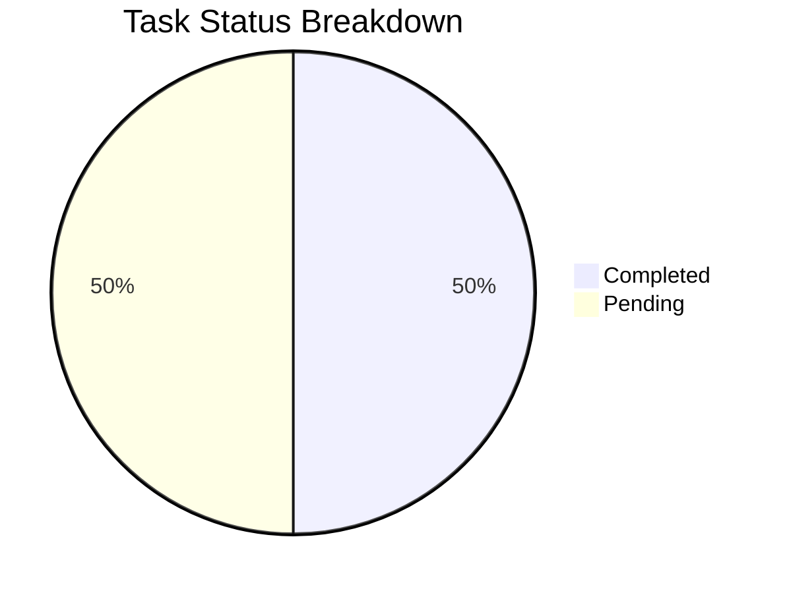
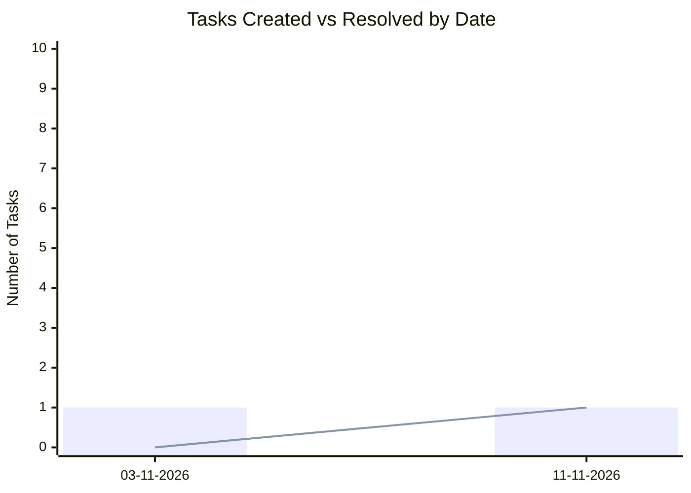

# 📊 Task & Progress Analytics: Koha

> Auto-generated analytics report tracking tasks created, resolved, and pending.

## 📈 Overall Metrics

- **Total Tasks**: `2`
- **Completed**: `1` (✅)
- **Pending**: `1` (⏳)
- **Resolution Rate**: `50.0%`

## 📅 Daily Throughput

| Date | Completed | Pending | Total | Status |
| :---: | :---: | :---: | :---: | :---: |
| 11-11-2026 | 1 | 0 | 1 | ✅ All Done |
| 03-11-2026 | 0 | 1 | 1 | ⏳ 1 In Progress |

*Bar: Total Created | Line: Resolved*
