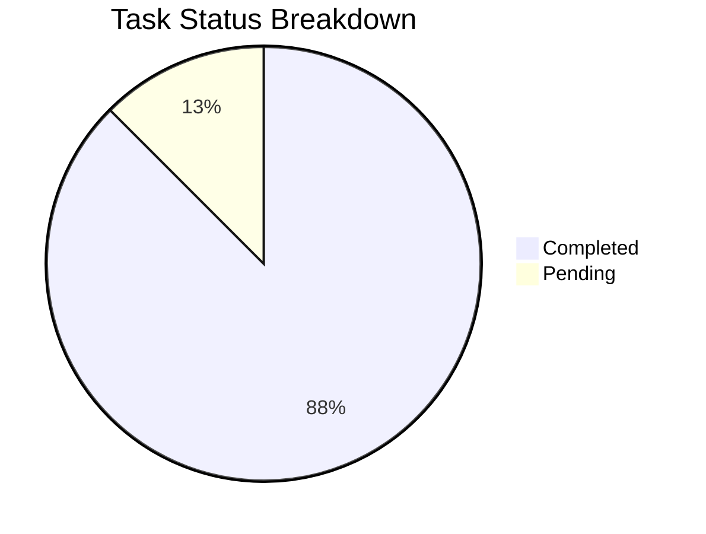
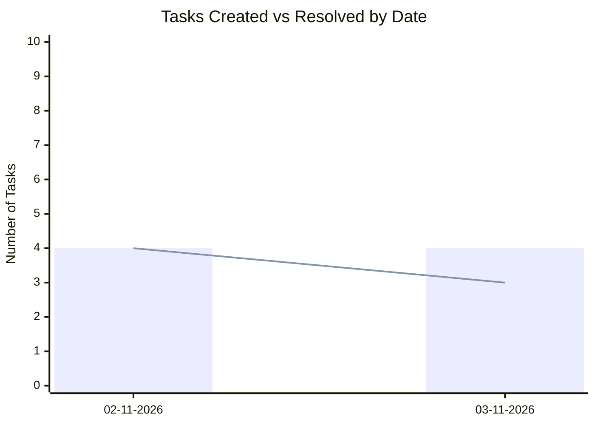

# 📊 Task & Progress Analytics: Sanchay

> Auto-generated analytics report tracking tasks created, resolved, and pending.

## 📈 Overall Metrics

- **Total Tasks**: `8`
- **Completed**: `7` (✅)
- **Pending**: `1` (⏳)
- **Resolution Rate**: `87.5%`

## 📅 Daily Throughput

| Date | Completed | Pending | Total | Status |
| :---: | :---: | :---: | :---: | :---: |
| 03-11-2026 | 3 | 1 | 4 | ⏳ 1 In Progress |
| 02-11-2026 | 4 | 0 | 4 | ✅ All Done |

*Bar: Total Created | Line: Resolved*
