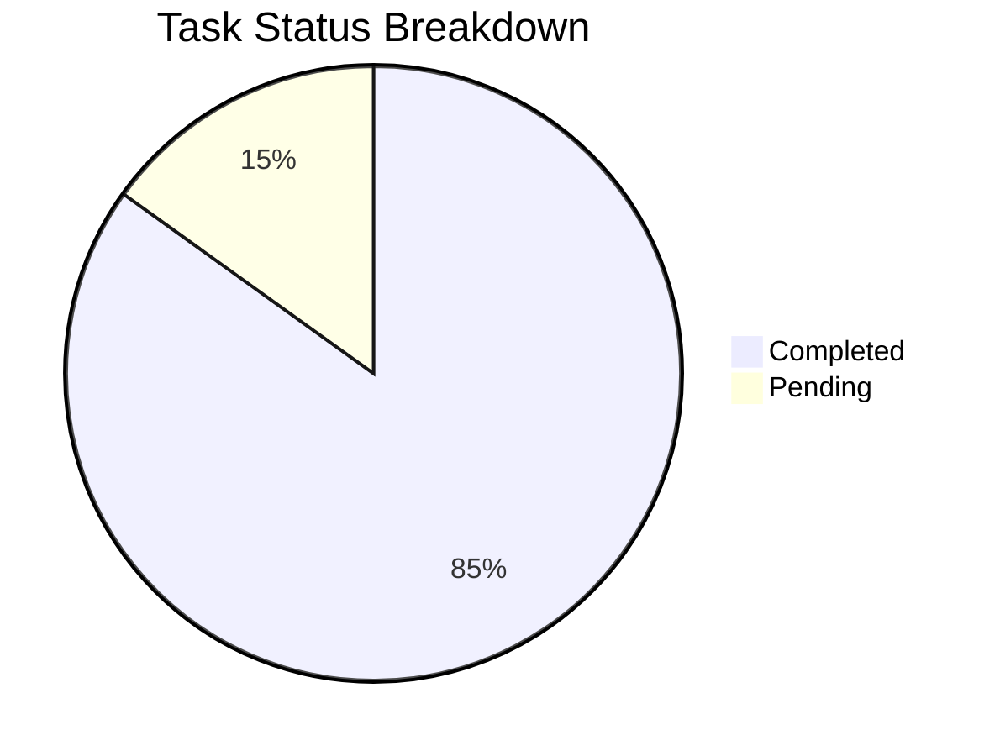
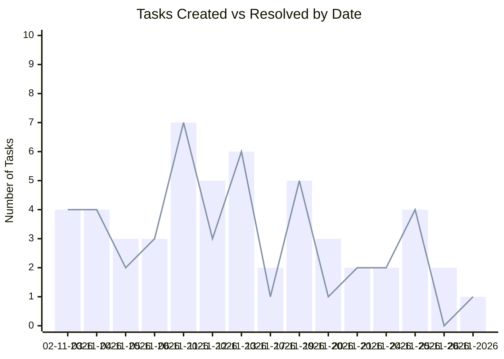

# 📊 Task & Progress Analytics: Sanchay

> Auto-generated analytics report tracking tasks created, resolved, and pending.

## 📈 Overall Metrics

- **Total Tasks**: `53`
- **Completed**: `45` (✅)
- **Pending**: `8` (⏳)
- **Resolution Rate**: `84.9%`

## 📅 Daily Throughput

| Date | Completed | Pending | Total | Status |
| :---: | :---: | :---: | :---: | :---: |
| 26-11-2026 | 1 | 0 | 1 | ✅ All Done |
| 25-11-2026 | 0 | 2 | 2 | ⏳ 2 In Progress |
| 24-11-2026 | 4 | 0 | 4 | ✅ All Done |
| 21-11-2026 | 2 | 0 | 2 | ✅ All Done |
| 20-11-2026 | 2 | 0 | 2 | ✅ All Done |
| 19-11-2026 | 1 | 2 | 3 | ⏳ 2 In Progress |
| 17-11-2026 | 5 | 0 | 5 | ✅ All Done |
| 13-11-2026 | 1 | 1 | 2 | ⏳ 1 In Progress |
| 12-11-2026 | 6 | 0 | 6 | ✅ All Done |
| 11-11-2026 | 3 | 2 | 5 | ⏳ 2 In Progress |
| 06-11-2026 | 7 | 0 | 7 | ✅ All Done |
| 05-11-2026 | 3 | 0 | 3 | ✅ All Done |
| 04-11-2026 | 2 | 1 | 3 | ⏳ 1 In Progress |
| 03-11-2026 | 4 | 0 | 4 | ✅ All Done |
| 02-11-2026 | 4 | 0 | 4 | ✅ All Done |

*Bar: Total Created | Line: Resolved*
