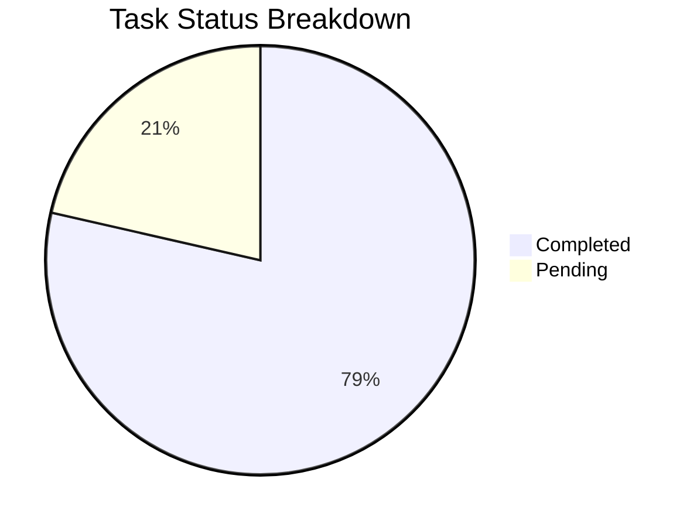
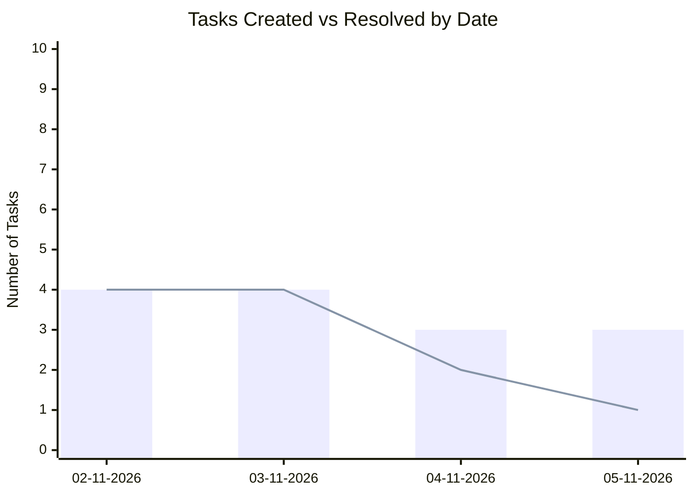

# 📊 Task & Progress Analytics: Sanchay

> Auto-generated analytics report tracking tasks created, resolved, and pending.

## 📈 Overall Metrics

- **Total Tasks**: `14`
- **Completed**: `11` (✅)
- **Pending**: `3` (⏳)
- **Resolution Rate**: `78.6%`

## 📅 Daily Throughput

| Date | Completed | Pending | Total | Status |
| :---: | :---: | :---: | :---: | :---: |
| 05-11-2026 | 1 | 2 | 3 | ⏳ 2 In Progress |
| 04-11-2026 | 2 | 1 | 3 | ⏳ 1 In Progress |
| 03-11-2026 | 4 | 0 | 4 | ✅ All Done |
| 02-11-2026 | 4 | 0 | 4 | ✅ All Done |

*Bar: Total Created | Line: Resolved*
